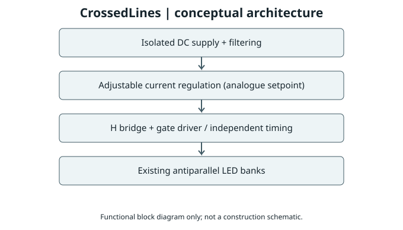

# CrossedLines

Sometimes the lights aren't the problem. It's the bloody controller.

A replacement controller for isolated low voltage two wire antiparallel LED strings. A MOSFET H bridge alternates polarity symmetrically whilst analogue current regulation controls brightness. The individual LED banks still experience modulation; the aim is to minimise perceptible artefacts without creating an RF nightmare.

## Development areas

| Codename | Work package |
|---|---|
| TheWormThatTurned | H bridge, dead time, gate drive, edge shaping, shoot through prevention |
| ThirteenAmp | Isolated DC supply, analogue current regulation, limiting, thermal and fault protection |
| RadioFour | Conducted and radiated emissions, cable currents, switching harmonics |
| GrannyByFlashlight | Photodiode measurements of each bank and combined light |
| YouCanSayThatAgain | Frequency, duty symmetry, jitter and repeatability |
| NothingTooMuchTrouble | Minimal resource timer based control, optional oscillator only approach |
| GoodnightFromHim | Symmetrical, controlled fade and shutdown |

Actual current consumption should be somewhat less than thirteen amps. The tree is not intended to be a broadcasting station.

## Implementation

Characterise string voltage, current, polarity, branch topology and original controller first. Use only isolated low voltage strings. A regulated current amplitude, rather than extra brightness PWM, sets output. Use a suitable high side/low side gate driver, hardware interlock and dead time. Evaluate current regulator compliance and transient response when the bridge commutates. Ensure safe startup, shutdown, open/short load behaviour and thermal margins.

Frequency is an experimental parameter, not a fixed promise: sweep from baseline through higher frequencies within component ratings, measuring optical artefacts, RF emissions and switching losses. Each bank is approximately 50% duty at symmetrical drive, minus dead time; do not confuse combined light with individual emitter modulation. Keep cable capacitance and current return paths in mind. Slow edges only as far as safe switching losses and timing permit.

## Control

Physical brightness control is fundamental. Optional [MakeItMatter](../MakeItMatter/) integration must not affect deterministic switching. A hardware timer or dedicated oscillator generates the reversal sequence, with DAC or potentiometer setting current amplitude. No unnecessary animation modes.

## Test plan

1. Record original electrical and optical waveforms and RF baseline.
2. Verify bridge timing into a suitable dummy load and then current limited LED string.
3. Sweep frequency, dead time, edge rate and current amplitude; observe overshoot, temperature and losses.
4. Measure each LED bank independently, at several points on the string and throughout dimming.
5. Compare conducted and radiated emissions, including near field measurements and receiver noise floor. Repeat with optional radio active and inactive.
6. Document fault handling and repeatability. See [shared measurement methods](../docs/Measurement-Methods.md).

Status: conceptual, untested. No claim of flicker free individual LED illumination.
