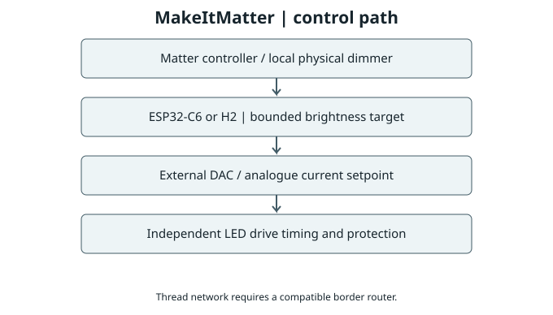

# MakeItMatter

*Because the lighting matters more than the connectivity.*

An optional local smart home extension for [CrossedLines](../CrossedLines/) and [Mastermind](../Mastermind/). Matter over Thread is the preferred implementation; ESP32-C6 can also support Matter over WiFi. ESP32-H2 provides IEEE 802.15.4 and BLE but no WiFi. Use a compatible Thread border router and Matter controller for Thread commissioning and operation.

## Design

- ESP32-C6 or ESP32-H2 with ESP-Matter; confirm SDK and device type support for chosen version.
- Standard dimmable light endpoint for on/off and brightness. Effects and activity controls are optional extensions; interoperability is not assumed.
- Physical controls operate without the network. Synchronise local and remote state; define power recovery and persistence.
- DAC or other analogue setpoint interface to LED current regulation. Neither chip is assumed to have a suitable onboard DAC.
- Dedicated hardware timing or independent controller handles H bridge reversal; never bit bang timing from networking tasks.
- Use protected, bounded setpoints and safe defaults if communication is lost. No mandatory cloud services.
- Keep antenna and RF return paths away from LED switching loops; test with radio enabled and disabled.

## Firmware concept

See [configuration example](firmware/config.h). This is a design placeholder, not buildable firmware. Network commands should update a bounded target brightness; a local control task applies a smooth analogue ramp while deterministic drive timing continues independently.

## Validation

Test commissioning, offline physical controls, reconnection, conflicting local/remote commands, power recovery, latency, and worst case optical/RF performance during radio traffic. Use Home Assistant or another compatible Matter controller. Confirm that the hardware remains safe on reset and loss of DAC communication.

References: [ESP-Matter](https://github.com/espressif/esp-matter), [ESP32-C6](https://www.espressif.com/en/products/socs/esp32-c6), [ESP32-H2](https://www.espressif.com/en/products/socs/esp32-h2).

Status: proposed architecture, not implemented.
